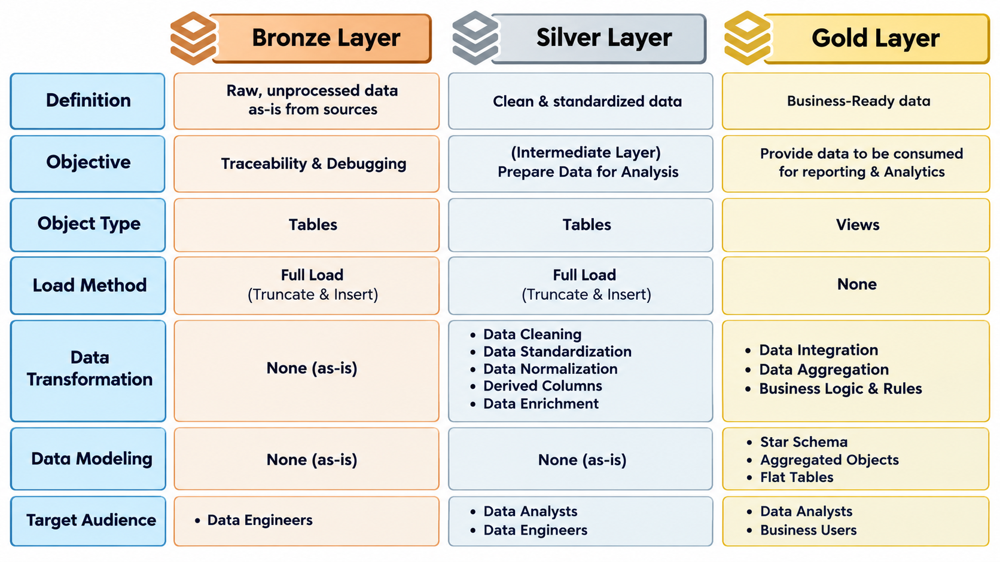
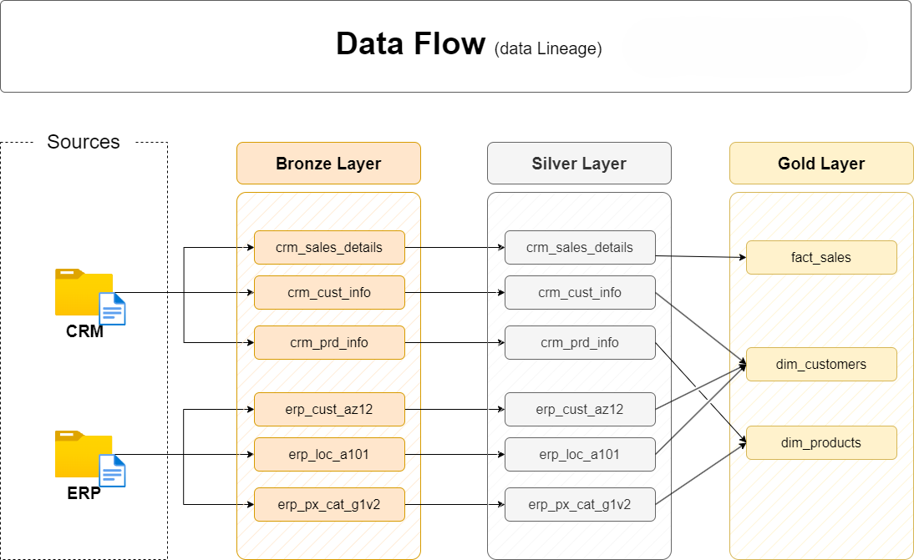
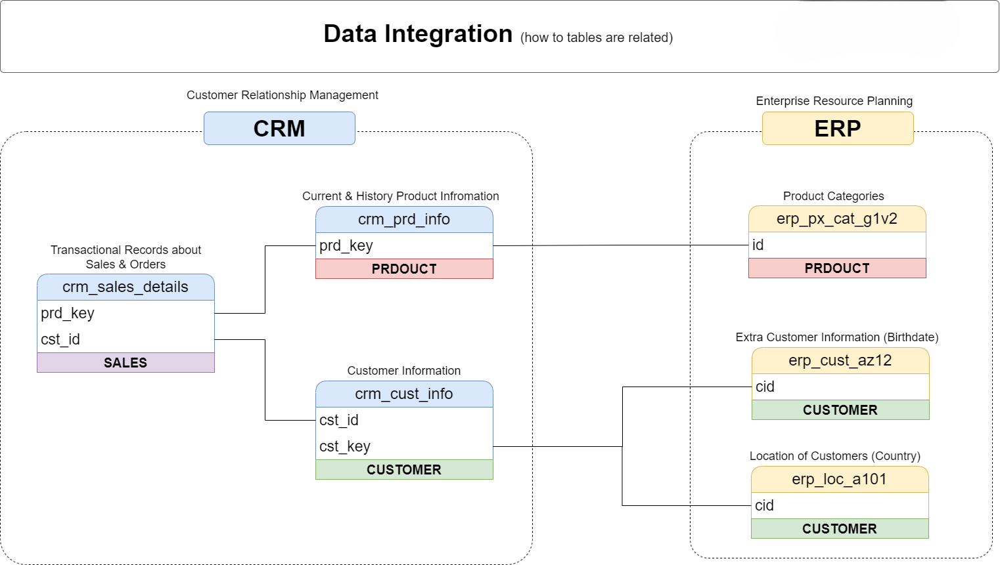
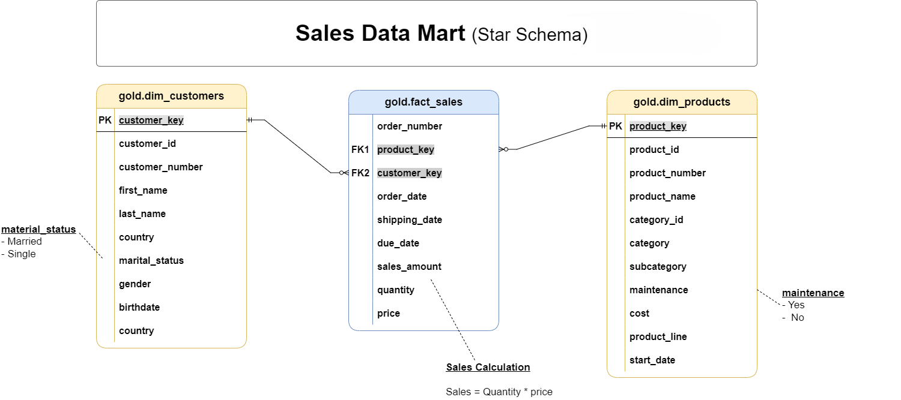

# 🚀 SQL Data Warehouse Project

### Building a Modern SQL Server Data Warehouse for Sales Analytics

## 📌 Overview

This project demonstrates the design and implementation of a modern **SQL Server Data Warehouse** that integrates sales data from two operational source systems: **ERP (Enterprise Resource Planning)** and **CRM (Customer Relationship Management)**.

The objective is to transform raw CSV files into clean, integrated, and business-ready data using SQL Server and T-SQL. The warehouse provides a reliable foundation for business intelligence, sales reporting, and data-driven decision-making.

## 🎯 Project Objectives

- **Data Sources:** Import data from two source systems (ERP and CRM), provided as CSV files.
- **Data Quality:** Identify and resolve data quality issues through data cleansing and validation before analysis.
- **Data Integration:** Consolidate data from both sources into a unified, user-friendly data model optimized for analytical queries and reporting.
- **Scope:** Work exclusively with the latest available dataset, without implementing historical data tracking or historization.
- **Documentation:** Provide clear and comprehensive documentation of the data model to support business stakeholders and analytics teams.

## 🏗️ Data Architecture

The project follows a medallion architecture that separates raw data ingestion, transformation, and business-ready data.



*Note: The layers describe the intended architecture and should reflect the actual implementation.*

## 🛠️ Technologies Used

- **Microsoft SQL Server**.
- **T-SQL**.
- **SQL Server Management Studio (SSMS)**.
- **CSV Files**.
- **Git & GitHub**.

## 📂 Data Sources
The project uses CSV datasets organized into two main directories: CRM and ERP.
- **CRM:** `datasets/crm_source/`
- **ERP:** `datasets/erp_source/`

## 🔄 Data Flow



## 🔗 Data Integration



## 🔄 ETL Pipeline

### 1. Extract
- Load ERP and CRM CSV files into Bronze tables (raw data).
- Preserve source data as-is for traceability and debugging.

### 2. Transform
- Load Bronze data into Silver tables using full load (truncate and insert).
- Clean, standardize, and normalize data.
- Create derived columns and enrich data.
- Load cleaned data into Silver tables for analysis.

### 3. Load
- Create Gold views from Silver data.
- Apply business rules, integrate data, and aggregate results.
- Organize data into star schemas, flat tables, and aggregated objects for reporting and analytics.

## 🧹 Data Quality & Validation

| Issue | Resolution |
|---|---|
| Missing values | Apply documented business rules or retain valid nulls |
| Duplicate records | Identify duplicates and apply deduplication rules |
| Inconsistent formats | Standardize and Normalize |
| Invalid data types | Validate and safely convert source values |

All cleansing and transformation rules should be documented to ensure data consistency and traceability.

## 🧱 Data Modeling

The warehouse uses **star schema** to make analytical queries easier to understand and maintain.

### Dimension Tables

- `dim_customers` — Customer information and attributes.
- `dim_products` — Product descriptions and categories.

### Fact Table

- `fact_sales` — Sales measures and foreign keys linking transactions to dimensions.



## 📁 Repository Structure

```text
SQL_Data_Warehouse_Project/
│
├── datasets/
│   ├── source_erp/
│   └── source_crm/
│
├── docs/
│   ├── 00_requirements.md
│   ├── 01_detailed_dwh_layers.png
│   ├── 02_high_level_dwh_architecture.png
│   ├── 03_naming_conventions.md
│   ├── 04_data_flow.png
│   ├── 05_data_integration.png
│   ├── 06_data_model.png
│   └── 07_data_catalog.md
│
├── scripts/
│   ├── init_database.sql
│   ├── bronze/
│   │   ├── ddl_bronze.sql
│   │   └── proc_load_bronze.sql
│   ├── silver/
│   │   ├── ddl_silver.sql
│   │   └── proc_load_silver.sql
│   └── gold/
│       └── ddl_gold.sql
│
├── test/
│   ├── quality_checks_gold.sql
│   └── quality_checks_silver.sql
│
├── LICENSE
└── README.md
```

*This is a suggested structure; adjust it to match the files in your repository.*

## 📋 Project Scope

This project focuses on a **current-state analytical data warehouse**.

- Only the latest available dataset is used.
- Historical tracking of changing customer and product attributes is out of scope.
- Slowly Changing Dimensions (SCD) are not implemented.
- Data cleansing and transformation are performed before analytical consumption.
- The warehouse is designed for analytical queries rather than transactional processing.

**Important:** Historical sales transactions may still be included in the source data. The exclusion of historization means the project does not maintain historical versions of changing dimension attributes.

## ✅ Expected Outcomes

- A centralized SQL Server data warehouse integrating ERP and CRM data.
- A structured ETL pipeline for CSV ingestion and transformation.
- Clean and validated data ready for analysis.
- A dimensional model optimized for reporting.
- Documented business rules and data structures.
- A foundation for SQL analytics and optional BI dashboards.

## 👤 Author

**Badreddine Brahim**

- GitHub: [Badreddine Brahim](https://github.com/BrahimBadreddine)

## 📄 License

This project is licensed under the MIT License.

---

*Built with SQL Server and T-SQL to transform raw ERP and CRM data into reliable, analytics-ready information.*
